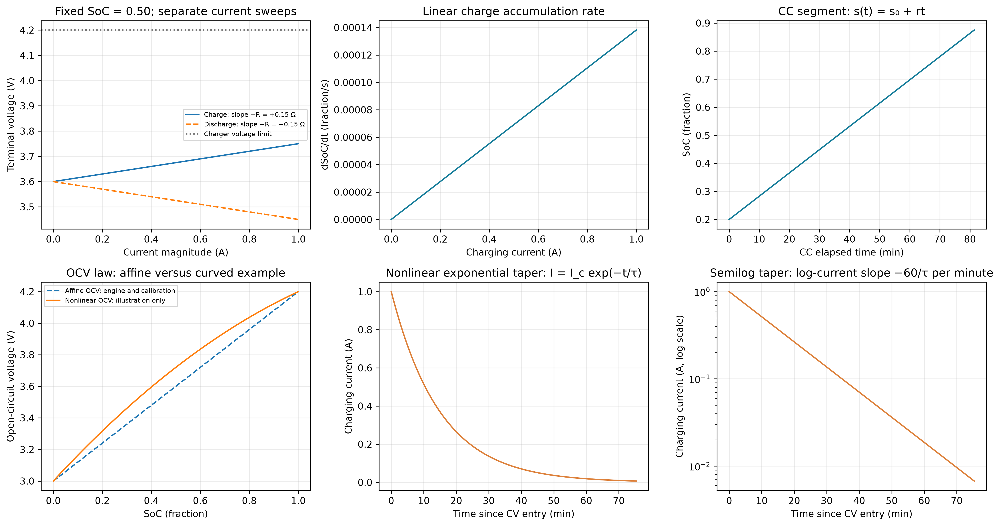
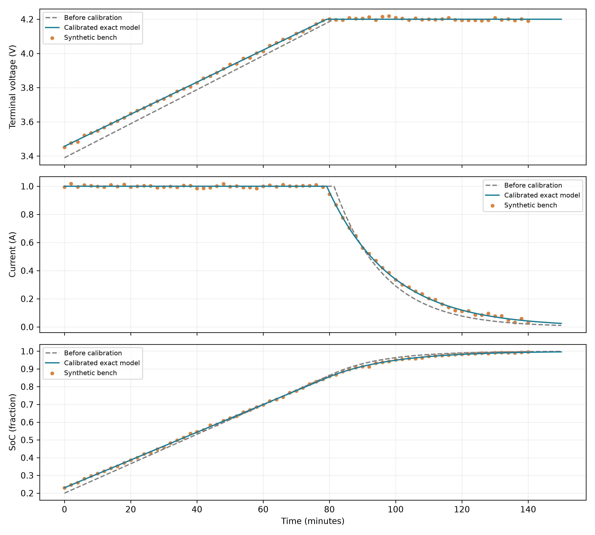
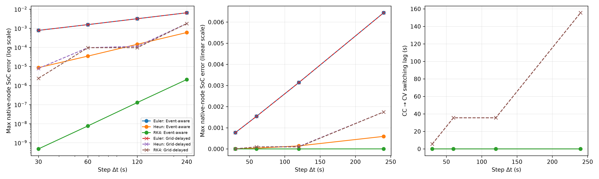
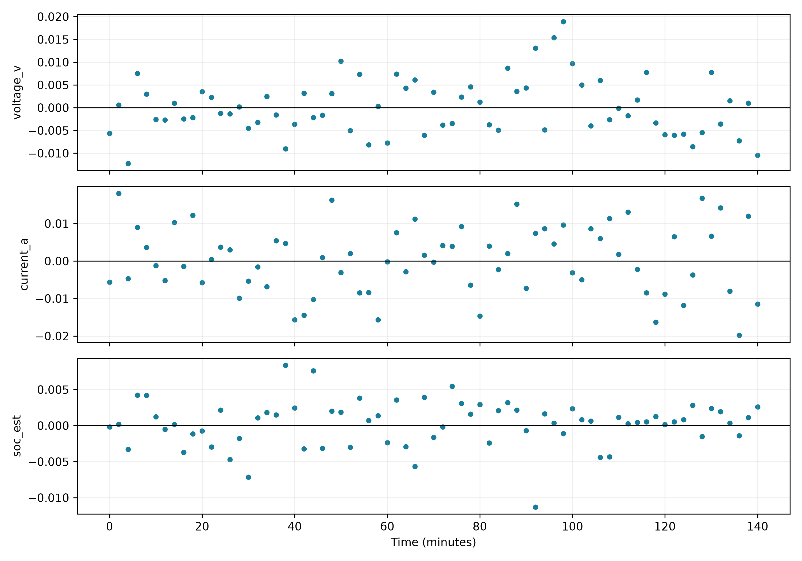

# CC/CV Smart Charger & Parameter Calibration Lab

## Math 3 — Project 3: Battery Charging

**Project claim.** A first-order ODE explains both the linear accumulation of charge under constant current and the exponential current taper under constant voltage. An interactive laboratory separates three sources of disagreement: discretization error, switch-event error, and physical model discrepancy. Parameter calibration links the equations to measurements. All supplied datasets are synthetic and are labeled accordingly; physical validation remains an experiment to perform.

**Deliverables.** `app.py` is the complete interactive lab; `charger/` contains the independent model, solvers, data and calibration modules. `generate_demo.py` creates reproducible charts and numerical tables in `outputs/`. `tests/` verifies numerical properties. The four parts below supply the report narrative and derivations. `PRESENTATION.md` supplies a demo script and oral-defense questions.

---

# Part 1 — Mathematical Model

## 1.1 Physical and circuit formulation

Take current positive **into** the cell. Let charge $q(t)$ be measured in coulombs and define state of charge $s=q/Q_C$, a dimensionless fraction. A capacity specified as $Q_{Ah}$ ampere-hours corresponds to $Q_C=3600Q_{Ah}$ coulombs. Coulombic efficiency $\eta$ gives

$$
\frac{dq}{dt}=\eta I(t),\qquad
\boxed{\frac{ds}{dt}=\frac{\eta}{3600Q_{Ah}}I(t)}.
$$

Use a series equivalent circuit: an ideal SoC-dependent voltage source $U(s)$ plus internal resistance $R$. Kirchhoff's voltage law, with the charging sign convention, gives

$$
\boxed{V_{term}=U(s)+RI},\qquad U(s)=a+bs,\quad b>0.
$$

The affine open-circuit-voltage (OCV) law is an **educational local approximation**, not a universal lithium-ion OCV curve. The state is $s$; voltage and current are algebraic outputs. This is one differential equation with a charger control law, rather than three independent ODEs.

An ideal charge-only regulator obeys

$$
I(s)=\max\left(0,\min\left[I_{CC},\frac{V_{max}-U(s)}{R}\right]\right).
$$

Within $U(s)<V_{max}$, this creates the two regimes below. For a monotone charging experiment we implement a latched sequence **CC → CV → OFF**, rather than repeatedly selecting a mode with a noisy comparator. Precharge, recharge and discharge are outside this implementation.

**CC phase**

$$
I=I_{CC},\quad \dot s=r=\frac{\eta I_{CC}}{3600Q_{Ah}},\quad
V_{term}=a+bs+RI_{CC}.
$$

**CV phase**

$$
V_{term}=V_{max},\quad I=\frac{V_{max}-a-bs}{R},\quad
\dot s=\frac{\eta(V_{max}-a-bs)}{3600Q_{Ah}R}
=\frac{s_\infty-s}{\tau},
$$

where

$$
s_\infty=\frac{V_{max}-a}{b},\qquad
\tau=\frac{3600Q_{Ah}R}{\eta b}.
$$

**Termination** is a separate event: during CV, turn charging off when $I\le I_{cut}$. Then $I=0$, $\dot s=0$ in the no-leakage model, and $V_{term}=U(s)$. The ideal resistor model predicts an immediate voltage decrease of $RI_{cut}$ at disconnect; real cells also exhibit slower polarization relaxation. Reaching $V_{max}$ starts CV; it does not by itself terminate charging. TI describes this regulated-current/regulated-voltage sequence and current-based termination in its charger documentation [1,2].

## 1.2 Symbols, units, ranges and initial conditions

The ranges below are illustrative **model exploration ranges**, not charging permissions. Actual charging limits must come from the chosen cell and charger documentation. Different lithium chemistries have different voltage limits.

| Symbol | Meaning and unit | Default | Illustrative scale |
|---|---|---:|---|
| $t,h=\Delta t$ | elapsed time and numerical step, s | $h=60$ | sampling 30–120 s; solver 1–240 s for this example |
| $s,s_0$ | SoC and initial SoC, fraction | $s_0=0.20$ | $0\le s\le1$; begin above any precharge region |
| $Q_{Ah}$ | effective capacity, Ah | 2.0 | 0.5–3 Ah for a small cell |
| $Q_C$ | capacity, C | 7200 | $3600Q_{Ah}$ |
| $\eta$ | coulombic efficiency, dimensionless | 0.995 | approximately 0.98–1 in an illustrative healthy-cell model |
| $I_{CC}$ | regulated current, A | 1.0 | 0.1–1 A in a small teaching setup, subject to ratings |
| $R$ | effective series resistance, Ω | 0.15 | 0.03–0.30 Ω as a broad lumped illustrative range |
| (a) | affine OCV intercept, V | 3.0 | approximate endpoint, independently established |
| $b$ | OCV slope, V per SoC fraction | 1.2 | local fit, often order 1 V/fraction; not universal |
| $U,V_{term}$ | open-circuit and terminal voltages, V | $U_0=3.24$ | differ by (RI) while charging |
| $V_{max}$ | CV regulation voltage, V | 4.20 | commonly 4.20 V for a compatible single cell [1]; other chemistries differ |
| $I_{cut}$ | CV termination threshold, A | 0.10 | example 0.05C; use actual charger/cell specification |
| $r$ | CC SoC rate, (s^{-1}) | $1.38194\times10^{-4}$ | depends on capacity and current |
| $\tau$ | CV relaxation time, s | 904.523 | determined by $Q,R,b,\eta$ |
| $s_{sw},t_{sw}$ | switching SoC and time | derived below | event values |

Here **1C** means current $Q_{Ah}$ amperes: for a 2 Ah cell, 1 A is 0.5C. $\eta$ is a charge efficiency, not energy efficiency. $b$ is volts per **fraction**, not per percent.

Initial conditions are consistent algebraically:

$$
s(0)=s_0,\quad U(0)=a+bs_0,\quad
V_{term}(0)=a+bs_0+RI(0).
$$

For the default case $I(0)=1\,A$, $U(0)=3.24\,V$ and $V_{term}(0)=3.39\,V$. Voltage is not an independent initial condition. If the initial state is already above $s_{sw}$, the charger begins in CV at $t_{sw}=0$ with a current below $I_{CC}$. If that current is already below $I_{cut}$, termination is immediate when enabled.

## 1.3 Assumptions and domain validity

1. Temperature, capacity, efficiency and resistance remain constant over a run; there is no aging or heat equation. Warming and resistance change can therefore create systematic residuals.
2. $U(s)=a+bs$ is an approximation over the fitted interval. Flat plateaus and end-of-charge curvature require a nonlinear OCV law and often a richer model.
3. No parallel load, self-discharge, diffusion or polarization RC branch is modeled. Current is cell current, not USB/source current.
4. The source has adequate voltage headroom, ideal regulation and an instantaneous CC/CV change. Real control loops have finite response, measurement delay and tolerance.
5. Charge-only operation requires $0\le s\le s_\infty\le1$. The app enforces $a<V_{max}\le a+b$ and $s_0<s_\infty$. A voltage limit lower than (a+b) yields an equilibrium below full modeled SoC.
6. CC-only mode is an intentionally unregulated counterexample. Its mathematical trajectory is shown beyond the valid region without clipping; it ceases to represent a physical cell once SoC or voltage leaves its allowed range.
7. The app does not implement low-voltage precharge, temperature lockout, safety timers, protection electronics, or hardware control. A real experiment must use a dedicated compatible charger that supplies these functions [2].

## 1.4 Analytical solution and exact switch event

**CC:** integrate a constant derivative:

$$
\int_{s_0}^{s(t)}ds=\int_0^t r\,dt
\quad\Rightarrow\quad s(t)=s_0+rt.
$$

The exact crossover occurs when **terminal voltage**, not OCV, reaches the regulation limit:

$$
a+bs_{sw}+RI_{CC}=V_{max},\quad
\boxed{s_{sw}=\frac{V_{max}-a-RI_{CC}}{b}}.
$$

If $s_0<s_{sw}$,

$$
\boxed{t_{sw}=\frac{s_{sw}-s_0}{r}}.
$$

Otherwise $t_{sw}=0$ and $s_c=s_0$; generally set $s_c=\max(s_0,s_{sw})$.

**CV:** write $\dot s+s/\tau=s_\infty/\tau$. Multiplication by $e^{t/\tau}$, followed by integration from $t_{sw}$, yields

$$
\boxed{s(t)=s_\infty-(s_\infty-s_c)e^{-(t-t_{sw})/\tau}},
$$

$$
\boxed{I(t)=I_c e^{-(t-t_{sw})/\tau}},\qquad
I_c=\frac{b}{R}(s_\infty-s_c).
$$

For a normal CC start $I_c=I_{CC}$, so $s,I,V_{term}$ are continuous at crossover. Their derivatives need not all be continuous: current begins to taper, while terminal voltage stops rising. The state derivative is continuous at the ideal switch.

**Termination:**

$$
s_{stop}=s_\infty-\frac{RI_{cut}}{b},\qquad
t_{stop}=t_{sw}+\tau\max\left(0,\log\frac{I_c}{I_{cut}}\right).
$$

When termination is enabled, keep $s=s(t_{stop})$ for later times and set $I=0$. A run beginning beyond $s_{stop}$ keeps its initial SoC and stops immediately.

**Time to a target:** for $s_0<s_T\le s_{sw}$, $t_T=(s_T-s_0)/r$. In CV,

$$
t_T=t_{sw}+\tau\log\left(\frac{s_\infty-s_c}{s_\infty-s_T}\right).
$$

This is finite only for $s_T<s_\infty$. With termination on, a target above the stopping SoC is unreachable. An initial state already at the target has $t_T=0$.

**Default benchmark:** $s_{sw}=0.875$, $t_{sw}\approx4884.42\,s=81.41\,min$, $\tau\approx904.52\,s$; $t_{95\%}\approx5713.23\,s=95.22\,min$. At $I_{cut}=0.1\,A$, $s_{stop}=0.9875$ and $t_{stop}\approx6967.16\,s=116.12\,min$. Full $s=1$ is approached asymptotically if taper is never terminated.

The affine hybrid model is analytically tractable. Numerical solvers are nevertheless useful for verifying the methods, handling events, and extending to nonlinear $U(s)$, time-varying parameters, polarization or temperature. For nonlinear OCV,

$$
t-t_c=\frac{3600Q_{Ah}R}{\eta}\int_{s_c}^{s(t)}\frac{d\xi}{V_{max}-U(\xi)}
$$

may lack an elementary inverse.

## 1.5 Special: equilibrium, stability and phase-line insight

For the unrestricted CV equation $f(s)=(s_\infty-s)/\tau$, equilibrium satisfies $f(s_\infty)=0$. Since $f'(s)=-1/\tau<0$, it is asymptotically stable:

$$
s<s_\infty:\ \dot s>0\quad\longrightarrow\quad s_\infty
\quad\longleftarrow\quad \dot s<0:\ s>s_\infty.
$$

The right-hand arrow is a **bidirectional mathematical extension**: it implies negative current. A charge-only regulator cannot remove charge, so when $U(s)\ge V_{max}$, it sets $I=0$; states above $s_\infty$ are stationary rather than converging back. Thus the physical charge-only model converges toward $s_\infty$ from below; do not claim global two-sided asymptotic stability for a charge-only charger.

With a nonlinear OCV law the local slope is

$$
f'(s_*)=-\frac{\eta U'(s_*)}{3600Q_{Ah}R}.
$$

A positive OCV slope produces local exponential attraction in the bidirectional extension. A nearly flat OCV plateau weakens SoC inference from voltage and slows this model's relaxation. With practical termination the OFF state freezes SoC; the charger intentionally stops short of the asymptotic equilibrium. Because leakage is omitted, every OFF state is an equilibrium of the OFF subsystem.

Under unregulated CC, $\dot s=r>0$ has **no equilibrium**. The predicted SoC and affine voltage grow linearly. This is unbounded mathematical overcharge, not a derived thermal runaway mechanism. Thermal runaway needs temperature and reaction dynamics absent here.

The generated phase-line figure illustrates the unrestricted CV vector field; its caption marks the unphysical extension. A direction field in the (t,s) plane has constant slope along each horizontal state level, approaching zero near equilibrium.

## 1.6 How measurements connect to parameters

If rested OCV at a known state is available, $R\approx[V_{term}-U(s)]/I$ during charge, subject to polarization/lead-drop errors. From a sufficiently fast, safe current step at nearly fixed SoC, $R_{eff}\approx\Delta V/\Delta I$; label it effective resistance at that timescale.

In CC,

$$
\frac{dV_{term}}{dt}=b\frac{\eta I_{CC}}{3600Q_{Ah}},
$$

while in CV,

$$
\log I(t)=\log I_c-\frac{t-t_{sw}}{\tau}.
$$

These provide initial estimates; avoid log-fitting near zero or when additive current noise dominates. Voltage alone during ideal CV equals $V_{max}$ and contains no information about taper parameters. Independently anchor the OCV law and current before estimating $Q,R,s_0$. Only $Q/\eta$ appears in the dynamics, so do not fit (Q) and $\eta$ simultaneously from this experiment alone.

---

# Part 2 — Numerical Solution

## 2.1 Deriving Euler, Heun and RK4

On a smooth regime write $\dot s=f(t,s)$, $t_{n+1}=t_n+h$. Integrate

$$
s(t_{n+1})=s(t_n)+\int_{t_n}^{t_n+h}f(t,s(t))\,dt.
$$

**Forward Euler** replaces the integrand by its left-endpoint value:

$$
\boxed{s_{n+1}=s_n+h f(t_n,s_n)}.
$$

CC gives $s_{n+1}=s_n+hr$. CV gives $s_{n+1}=s_n+h(s_\infty-s_n)/\tau$.

**Heun / Improved Euler:** first predict using Euler, then average start/end slopes (a trapezoidal approximation):

$$
k_1=f(t_n,s_n),\quad s_P=s_n+hk_1,\quad k_2=f(t_n+h,s_P),
\quad\boxed{s_{n+1}=s_n+\frac h2(k_1+k_2)}.
$$

**Classical RK4:** choose four slopes whose weighted average matches the Taylor series through fourth order:

$$
k_1=f(t_n,s_n),\quad
k_2=f(t_n+h/2,s_n+hk_1/2),
$$
$$
k_3=f(t_n+h/2,s_n+hk_2/2),\quad
k_4=f(t_n+h,s_n+hk_3),
$$
$$
\boxed{s_{n+1}=s_n+\frac h6(k_1+2k_2+2k_3+k_4)}.
$$

Within a fixed regime this project is autonomous, so code passes just $s$ to (f). Under CC all stage slopes equal $r$, so **all three methods are exact up to roundoff**. Comparisons must include CV to reveal their different orders.

## 2.2 Event-aware switching and termination

For a step starting in CC, calculate the event duration

$$
h_e=\frac{s_{sw}-s_n}{r}.
$$

If $0\le h_e\le h$, advance exactly to $t_n+h_e$, set $s=s_{sw}$, latch CV, then integrate the remaining $h-h_e$ with the selected numerical method. Otherwise use a full CC step. The exact affine CC event locator is not a general nonlinear-event algorithm; an extended model would use root finding and dense output.

For termination, detect a crossing of $s_{stop}$ inside a CV step, bisect the duration using the same numerical step function, insert the event node, then hold SoC constant. This produces a **numerical** termination time; it is not silently replaced by the exact termination formula. Bisection assumes a sensible monotone step, which is why coarse unstable runs should be investigated without termination. The app issues a coarse-step warning.

OFF produces a jump in the algebraic current and terminal voltage. SoC remains continuous. Connecting plot nodes across a jump is a display approximation; residual predictions use the exact phase at the measurement time.

## 2.3 Accuracy and stability

For a smooth solution the one-step state defect (local truncation error without dividing by (h)) is (O(h^{p+1})), while accumulated global state error over a fixed interval is (O(h^p)). Some books divide the local defect by $h$, giving a local-error convention of (O(h^p)).

| Method | RHS evaluations per smooth step | One-step defect | Global error | CV negative-real-axis stability |
|---|---:|---:|---:|---|
| Euler | 1 | (O(h^2)) | (O(h)) | $0<h/\tau<2$ |
| Heun | 2 | (O(h^3)) | (O(h^2)) | $0<h/\tau<2$ |
| RK4 | 4 | (O(h^5)) | (O(h^4)) | $0<h/\tau\lesssim2.7853$ |

To derive these limits set $z=s-s_\infty$, $\dot z=-z/\tau$ and $x=h/\tau$. The amplification factors are

$$
G_E=1-x,\quad G_H=1-x+x^2/2,\quad
G_R=1-x+x^2/2-x^3/6+x^4/24.
$$

Asymptotic numerical stability requires (|G|<1). Euler's $x\le1$ also preserves a monotone approach from below; (1<x<2) gives decaying oscillations and can imply negative charging current. Heun's $G_H>0$ gives a nonoscillatory endpoint decay for (0<x<2), although its predictor can lie outside the physical interval when (x>1). RK4's endpoint amplification is positive on this real interval, but intermediate stages can still leave the domain. **Linear stability alone does not guarantee accuracy, physical stage values or reliable event detection.**

A useful starting accuracy choice is $h\le0.1\tau$, followed by halving $h$. There is no universal acceptable step: the time resolution of measurements and required time-to-target precision also matter. RK4's larger stable interval is not permission to use a step near its stability boundary.

For an error quantity $E(h)\approx Ch^p$, estimate

$$
p_{obs}=\frac{\log[E(h)/E(h/2)]}{\log 2}.
$$

The app computes max native-node SoC error to avoid linear output interpolation masking RK4 order. Roundoff-level errors, an all-CC horizon, or event-grid alignment make this ratio meaningless; such cases are shown as missing orders. A time-to-target error also depends on slope: $\delta t\approx\delta s/|\dot s(t_T)|$, so a small SoC error can cause a larger timing error near the end of taper.

## 2.4 Special: switching timing drift and chattering

The comparison includes a deliberately naive **grid-delayed** switch: advance the whole CC step, check $V_{term}\ge V_{max}$ at its end, and enter CV only then. If the grid starts at zero and the switch is not already active,

$$
t_{sw,h}=h\left\lceil\frac{t_{sw}}h\right\rceil,
\quad 0\le\delta t=t_{sw,h}-t_{sw}<h.
$$

During the excess CC interval the voltage excursion is at most approximately (brh). Just before the delayed mode change the overshoot is $br\delta t$. The displayed grid node is post-switch and therefore shows regulated voltage; the overshoot occurred within the unobserved interval. Native-node SoC errors and switch lag still expose the damage.

For this ideal model, **Euler, Heun and RK4 have the same grid-delayed switching time**, because CC is integrated exactly by all three. A higher-order smooth solver does not fix a poorly located event.

There is a useful refinement: the state vector field is continuous at the ideal switch. Let $\delta=t_{sw,h}-t_{sw}$. The delayed CC state at that time exceeds the true CV state by

$$
\Delta s=r\delta-r\tau(1-e^{-\delta/\tau})
=\frac{r\delta^2}{2\tau}+O(\delta^3).
$$

Thus switching-time error is (O(h)), while the local state discrepancy here is (O(h^2)), rather than automatically (O(h)). This can cap RK4's effective state convergence around second order under naive switching, and give irregular observed orders as event/grid alignment changes. Other hybrid models with discontinuous state derivatives can suffer a first-order state defect. Do not claim one universal order reduction.

**Chattering** is rapid repeated mode toggling. In a monotone, noiseless CC/CV model with a one-way switch it does not occur. It can arise if a sampled implementation re-evaluates a noisy voltage comparator in both directions, or if numerical overshoot and an incorrect regulator produce contradictory mode decisions. A real bidirectional controller may use hysteresis/debounce, for example different voltage thresholds for entering and leaving CV. This lab uses a one-way latch, so it demonstrates drift and instability without inventing artificial chatter. The same latch prevents switching back to CC when voltage falls at termination.

## 2.5 Error metrics

For a specified channel in its own units, let $y_i$ be reference/experimental values and $\hat y_i$ predictions at the **same times**. Define

$$
e_i=y_i-\hat y_i,\quad AE_i=|e_i|,\quad
MAE=\frac1N\sum_i|e_i|,
$$
$$
RMSE=\sqrt{\frac1N\sum_i e_i^2},\quad
E_{max}=\max_i|e_i|,\quad bias=\frac1N\sum_i e_i.
$$

MAE is typical absolute discrepancy; RMSE penalizes large residuals more; max error identifies the worst sampled disagreement. None is a percentage unless normalized and labeled. Compute voltage in V, current in A, and SoC in fraction separately. Multiply SoC-fraction error by 100 to express percentage points. Never average raw volts, amperes and SoC fractions together.

Numerical-reference metrics compare a solver with the exact solution of the **same model**. Experimental metrics compare measurements with the model and include sensor error and model mismatch. The app evaluates the exact model at each measurement time for calibration metrics. This cleanly separates the two questions. Missing measurements are excluded per channel; `n` is exported.

## 2.6 Parameter calibration and identifiability

Choose $\theta=(Q_{Ah},R,s_0)$, with $a,b,\eta,I_{CC},V_{max}$ independently fixed. For channel $c\in\{V,I,s\}$ and reported sensor uncertainty/scale $\sigma_c$, minimize

$$
\boxed{\hat\theta=\arg\min_{\theta\in\mathcal B}
\sum_c\sum_{i\in\mathcal I_c}
\left[\frac{\hat y_c(t_i;\theta)-y_{c,i}}{\sigma_c}\right]^2}.
$$

The code uses bounded `scipy.optimize.least_squares` with a linear loss and exact trajectories [3]. Bounds are $0.1\le Q_{Ah}\le10$, $0.005\le R\le1$, and $0\le s_0<\min(1,s_\infty)$; these are optimization limits, not physical specifications. The sample scales are 6 mV, 8 mA, and 0.003 SoC fraction. Use actual measurement uncertainties where known. Fitting can also select only a subset of parameters.

Inspect the sensitivity/Jacobian $J_{ij}=\partial r_i/\partial\theta_j$. Nearly dependent columns mean the observations cannot reliably distinguish parameters. The lab exports numerical rank and a condition estimate after scaling columns by parameter-bound widths, and warns about weak identification or an active bound. These diagnostics are local and are not confidence intervals. A full-rank Jacobian is not proof that the model is physically correct.

Examples of confounding:

- Only CV voltage: $V_{term}=V_{max}$ regardless of $Q,R,s_0$, so parameters cannot be identified.
- CV current taper without an OCV/SoC anchor: the decay strongly identifies $\tau=3600QR/(\eta b)$, not necessarily every factor independently.
- (Q) and $\eta$ are structurally confounded through $Q/\eta$.
- If `soc_est` is obtained from the same current trace by coulomb counting, treating it and current as independent data overstates evidence. Prefer fitting voltage/current and using SoC as a secondary check, or model their covariance.

Collect both CC and CV, fix the OCV calibration, and retain an independent validation run. Report before/after training errors separately from errors on the held-out run. A time split within one run is useful for testing extrapolation but is weaker than a separate run. The app labels its metrics as **in-sample**; it does not claim independent validation. Near the OFF discontinuity, timing errors dominate current residuals, so the default synthetic dataset and fit use uninterrupted taper with termination disabled.

---

# Part 3 — Programming by Python

## 3.1 Complete runnable implementation

The accompanying files are the complete source code, with no omitted solver or fitting routines:

| File | Responsibility |
|---|---|
| `charger/model.py` | validated parameters, circuit outputs, exact CC/CV trajectory and event/target times |
| `charger/solvers.py` | Euler, Heun, RK4; split-step and grid-delayed switching; numerical termination; convergence tables |
| `charger/analysis.py` | MAE/RMSE/max/bias metrics; weighted bounded calibration; local identifiability checks |
| `charger/data.py` | strict CSV loader and fixed seeded synthetic bench |
| `charger/plots.py` | reusable charging, residual, convergence and direct-physics relationship figures |
| `charger/export.py` | summaries, unit-labeled parameter tables, JSON cleaning and allowlisted source ZIP export |
| `app.py` | Streamlit controls, overlays, calibration, residuals, convergence and downloads |
| `generate_demo.py` | deterministic CSV, JSON, charts and comparison tables for a report |
| `tests/test_lab.py` | exactness, event timing, solver order, termination, fitting and invalid-input checks |
| `tests/test_app.py` | independent sections, fit lifecycle, error isolation and inspection of the actual download payload |
| `tests/test_relationships_export.py` | physical slopes, curved OCV, local-defect orders and archive/PNG checks |

The app has three independent calculation sections plus a physics panel and export tab. Each calculation form has its own physical settings and widget keys. Submit a form to apply its changes; Streamlit batches form values [5]. Identical settings reuse cached calculations [6]. Calibrating Section 3 never silently changes Sections 1 or 2. Match their inputs explicitly when a same-model comparison is intended.

| Section | Independent inputs | Dedicated outputs |
|---|---|---|
| 1 — CC/CV Simulation Engine | cell/charger parameters, method, switch policy, step, duration, target, termination | exact/numerical profiles, crossover, target time, cutoff time, explicit 100% reachability |
| 2 — Numerical Solver & Convergence Lab | its own cell/charger parameters, base step and duration | all three solvers, global errors, local defects, observed orders and crossover lag |
| 3 — Experimental Overlay & Calibration | its own assumptions, CSV/sample, fit subset and noise scales | before/after overlay, fitted parameters, per-channel errors and residuals |
| Physics Relationships | its own parameters, fixed SoC and illustrative OCV curvature | direct physical graphs and exportable relationship tables |

Resistance/capacity controls determine the time constant; tau is not a redundant free parameter. Section 1 reports time to a selected practical target and finite cutoff completion when enabled. For regulated CV, exact time to its full equilibrium is asymptotic; a fabricated finite “100% charge time” would be mathematically incorrect.

### Physics-style relationships and the sign correction

At fixed SoC, keep $U$ constant while varying current in a conceptual circuit experiment:

$$
V_{term}=U+RI_{in},\quad \frac{dV_{term}}{dI_{in}}=+R\quad\text{(charging)},
$$

$$
V_{term}=U-RI_{out},\quad \frac{dV_{term}}{dI_{out}}=-R\quad\text{(discharging)}.
$$

The requested negative slope belongs to the outward-current convention. Showing $-R$ while calling inward current positive would contradict the circuit equation. Both lines are displayed with explicit legends. They are fixed-state constitutive sweeps, not a single time-evolving charging run. The regulator may prevent portions above its voltage limit from being attained.

The panel also plots the linear rate law $\dot s=\eta I/(3600Q_{Ah})$ and the CC-only interval $s=s_0+rt$. If the cell starts in CV, the CC interval has zero length.

For a curved OCV illustration, use

$$
U_{illustration}(s)=a+bs+ks(1-s),\qquad |k|<b.
$$

It has the same endpoints as the affine law. Since $U'_{illustration}=b+k(1-2s)\ge b-|k|>0$, it remains monotone on $[0,1]$. The control is $k/b$ with range $[-0.8,0.8]$. This is an illustrative nonlinear relationship, not a measured cell curve. **The charging engine and calibration continue to use the affine law** so their exact benchmark and parameter meanings remain consistent. Changing curvature affects only the physics panel.

CV current $I=I_c\exp(-u/\tau)$ is curved on ordinary axes and straight when plotting $\log I$ versus seconds, with slope $-1/\tau$. The semilog graph's displayed horizontal axis is minutes, so its slope there is $-60/\tau$ per minute. Section 2 supplies error-versus-step plots on both log-log and ordinary linear axes. Its isolated one-step defect table demonstrates local orders 2, 3 and 5 separately from global orders 1, 2 and 4.



### Reproducible synthetic results

The supplied seeded dataset produces the following in-sample results (rounded; full precision is exported):

| Quantity | Baseline | Calibrated | Hidden synthetic truth |
|---|---:|---:|---:|
| Capacity (Ah) | 2.0000 | 2.1205 | 2.1200 |
| Resistance (Ω) | 0.1500 | 0.1803 | 0.1800 |
| Initial SoC (fraction) | 0.2000 | 0.23045 | 0.2300 |
| Voltage RMSE (V) | 0.03512 | 0.00606 | — |
| Current RMSE (A) | 0.03030 | 0.00897 | — |
| SoC RMSE (fraction) | 0.01450 | 0.00317 | — |

At 60 s steps over 9000 s, the default event-aware model has maximum native-node SoC errors approximately 0.001543 (Euler), 0.00003456 (Heun), and 0.000000007575 (RK4). These are numerical errors under an ideal model, not expected real-cell accuracy. The experiment-to-model residuals remain much larger because the synthetic measurements contain noise.







The export tab provides one **Download complete presentation ZIP** button. Its archive includes `summary.md`, `summary.txt`, `diagnostics.json`, a manifest, all available parameter/error/trajectory/convergence/local-defect/relationship CSVs, 300-dpi PNGs for charging/convergence/overlay/residuals/physics, and the complete allowlisted source with report and bilingual guide under `source/`. The calibrated-parameter CSV includes units. Missing measurements remain blank in CSV; missing diagnostic scalars become JSON null. Each section's independent settings are recorded.

Changing assumptions or data inside Section 3 invalidates its fit. Other sections' controls leave that fit intact. If a section has invalid inputs, the others continue; export records the error and omits that section's unavailable outputs. Correct all errors before claiming a complete bundle. The code intentionally excludes the virtual environment, git metadata and unrelated local files. The offline generator also creates `outputs/presentation_bundle.zip` with summaries, tables, high-resolution figures and source.

## 3.2 Setup and run guide

Use Python 3.11 or 3.12. In a terminal opened in this project directory:

```powershell
py -3.12 -m venv .venv
.\.venv\Scripts\python.exe -m pip install --upgrade pip
.\.venv\Scripts\python.exe -m pip install -r requirements.txt
.\.venv\Scripts\python.exe -m streamlit run app.py
```

If `py` is unavailable but `python` resolves to an installed supported interpreter, replace the first command with `python -m venv .venv`. Using the virtual environment's executable directly avoids PowerShell activation-policy issues. For an explicit package command:

```powershell
.\.venv\Scripts\python.exe -m pip install "numpy>=1.26,<3" "scipy>=1.12,<2" "matplotlib>=3.8,<4" "pandas>=2.1,<4" "streamlit>=1.40,<2"
```

Streamlit's official guide supports installation with pip and module launch with `python -m streamlit run app.py` [4]. Linux/macOS equivalents use `python3 -m venv .venv` and `.venv/bin/python`.

Verification and static report-asset generation:

```powershell
.\.venv\Scripts\python.exe -m unittest discover -s tests -v
.\.venv\Scripts\python.exe generate_demo.py
```

Open the Streamlit URL printed in the terminal (normally `http://localhost:8501`). Stop the server with Ctrl+C. No API key or cloud service is required. The tested dependency snapshot is recorded in `requirements-lock.txt` when available.

## 3.3 Suggested app workflow

1. Section 1: keep defaults and termination off; press **Calculate simulation**. Inspect exact/numerical crossover and target times. Enable termination for finite practical completion; exact 100% remains unreachable under regulated CV.
2. Section 2: use its independent controls and press **Calculate convergence**. Compare event-aware and grid-delayed policies, switch lag and state error. For a clean smooth-order example set this section's $s_0=0.90$ and base step to 80 s. Expect global orders near 1/2/4 and local orders near 2/3/5.
3. Section 3: select the synthetic bench and keep termination off. Press **Auto-calibrate**. Inspect fitted $Q,R,s_0$, before/after errors and residuals, then reveal ground truth. Only this section uses the fitted parameters.
4. Physics tab: inspect the charging/discharging slopes and CC/rate laws. Change its curvature control and calculate again. The nonlinear OCV illustration changes without changing the affine model in other tabs.
5. Upload real data in Section 3 with that section's physical settings matched to the experiment. Fix OCV and efficiency from independent evidence, set noise scales and fit an identifiable subset.
6. If transferring calibrated values to Sections 1 or 2, enter them explicitly and submit their forms. Preserve the original training trace and evaluate an independent validation run without re-fitting.
7. Submit all forms, correct any invalid section, and use the export tab's single ZIP button. See `PRESENTATION.md` for the bilingual slide script and rehearsed demo.

For the fixed synthetic bench, the true parameters are $Q=2.12\,Ah$, $R=0.18\,\Omega$, $s_0=0.23$, with all other defaults unchanged. The generator includes 71 samples spaced by 120 seconds over 8400 seconds. Gaussian measurement perturbations use a fixed seed of 2026 and known scales. It deliberately does **not** turn off at $I_{cut}$, so fit with termination off. Exact recovery is not expected in the presence of noise; computed values and measured errors are in `outputs/sample_calibration.json` and `outputs/calibration_metrics.csv`.

---

# Part 4 — Experiment

## 4.1 Safe practical setup

Use a supervised university bench with a **protected rechargeable single cell and a documented charger module matched to that cell's chemistry**. A small commercial charger/evaluation board with CC/CV regulation, current termination, temperature sensing and safety timing is preferable to directly programming a generic supply. The BQ24074 is one documented example of a single-cell charger with temperature monitoring and programmable termination; select a complete appropriate board rather than wiring a bare IC for this project [2].

Conceptual connections:

```text
approved low-voltage supply → compatible dedicated charger → protected cell
                                      │              │
                              current logger   high-impedance voltage logger
                                               temperature probe at cell
```

Use a properly rated isolated/differential logger where necessary; verify that oscilloscope/USB grounds cannot short charger nodes. Measure current in the **battery branch**. Prefer the charger's documented current monitor or a suitable current sensor to inserting an unfamiliar ammeter. If a supervised instructor uses a series meter, verify its fused range and connections with power off. Never place a current-mode meter directly across a cell.

Before energizing, identify the exact cell, voltage/current ratings, connector polarity, charger termination setting, permitted charging temperature window and emergency shutdown procedure. Use the lower of cell/charger/instructor-approved limits. Temperature safety timers and charger configuration must follow the actual board documentation [2]; the simulation sliders are not equipment settings.

Do not short, puncture, crush, reverse-connect, heat, bypass protection, or charge a damaged/swollen/leaking/unknown cell. Do not charge unattended. Place the setup on an appropriate noncombustible bench surface, monitor temperature continuously, and stop through the approved disconnect procedure on swelling, odor, abnormal heating or a protection fault. Follow the lab's battery incident procedure rather than handling a failing cell. Do not attempt to rescue a deeply discharged cell; this model omits precharge. Do not deliberately test overcharge or thermal runaway. An ordinary resistor and bench supply alone are not a substitute for a compatible lithium-cell charger.

**No-hardware fallback:** use the app's seeded synthetic bench or regenerate `outputs/synthetic_experiment.csv`. State on every chart: “simulated bench; no physical measurements.” This validates implementation and recovery under known assumptions, not real-cell fidelity. The complete project is demonstrable without battery hardware.

## 4.2 Measurement protocol and CSV format

1. Record the cell ID, nominal capacity, charger model, configured current, CV voltage, termination threshold, ambient temperature, sensors, ranges and stated uncertainties. Check logger timestamps against one clock.
2. Obtain an initial SoC/OCV anchor using a documented battery gauge or instructor-approved rested OCV procedure. Do not infer SoC directly from loaded terminal voltage using a linear rule unless you explicitly label that assumption.
3. Start logging before charging. Define `time_sec=0` at charge start; record simultaneous voltage/current, and temperature in a separate log or optional extra CSV column. The loader retains only the four analysis columns.
4. Sample every 30–60 s for a physical bench where feasible; increase time resolution around the expected CC/CV crossover. The 120 s synthetic interval is only a dry-run choice. Continue through enough CV taper to identify $\tau$; record termination and a few post-disconnect readings if allowed by the lab procedure.
5. Stop charging through the documented charger controls; do not use SoC=100% in the app as a hardware stop command. No unattended repetition.
6. Preserve raw data. Export numeric seconds, volts, amperes and SoC fraction. Use blank values for missing readings. Keep positive current for charging. Do not shift or smooth data merely to improve metrics; document any processing.
7. Repeat on a separate run for validation, using approved starting conditions. Keep this run out of parameter fitting.

Schema example (illustrative formatting, not an experimental claim):

```csv
time_sec,voltage_v,current_a,soc_est
0,3.390,1.000,0.2000
60,3.400,1.000,0.2083
120,3.410,1.000,0.2166
180,3.420,1.000,0.2249
```

`time_sec` and at least one measured channel are required. Rows are sorted by time. Duplicate timestamps, negative/missing times, nonnumeric values, infinities, negative charging current and SoC percentages are rejected. At least four rows are required. Do not enter made-up SoC if it is unavailable; omit that column or leave it blank. For genuine discharge data use a different model/sign convention.

If estimating SoC by current integration,

$$
s_i\approx s_0+\frac{\eta}{3600Q_{Ah}}\sum_{j<i}\frac{I_j+I_{j+1}}2(t_{j+1}-t_j).
$$

This assumes an initial anchor and a known effective capacity, and accumulates current offset errors. It is not a direct measurement, and it is correlated with the current channel used to create it. Report that dependence explicitly.

## 4.3 Theory, numerics and experiment comparison

First choose charger settings corresponding to the log, then upload its CSV. Inspect the uncalibrated exact and numerical curves before fitting. Use independently estimated $a,b,\eta,I_{CC},V_{max}$, choose identifiable fit parameters, set sensor scales, and calibrate. Keep separate comparisons:

| Comparison | What it tests | Appropriate evidence |
|---|---|---|
| Euler/Heun/RK4 vs exact same model | numerical implementation and step error | order study, max SoC error, event lag |
| Exact calibrated model vs fitting run | how well parameters reproduce available observations | in-sample per-channel MAE/RMSE/max/bias |
| Fixed calibrated model vs independent run | predictive usefulness and physical model validity | held-out residuals and metrics |

The app automates the first two. For the third, retain the calibrated parameter values, enter those values as the physical controls, upload the independent run and evaluate without pressing calibrate. Adjust the initial SoC only if independently measured and explicitly report that adjustment. Do not silently re-fit the validation trace. A low synthetic error does not substitute for this step.

## 4.4 Special: residual pattern and physical discrepancy diagnosis

Plot $e_i=y_{exp,i}-y_{model,i}$ against time separately for voltage, current and SoC. Show a zero line and mark crossover/termination where relevant. Inspect both uncalibrated and calibrated residuals: fitting can remove useful evidence of a missing mechanism.

| Pattern | Plausible interpretation | Follow-up check |
|---|---|---|
| Positive CC voltage residual scaling with current | actual $R$ or lead resistance exceeds assumed value; polarization may contribute | compare a safe measured current-step response; inspect lead measurement points |
| Voltage residual falls as CV current falls | current-dependent voltage drop or polarization omitted | plot voltage residual vs current, not only vs time |
| Positive current residual late in CV | model tapers too quickly $predicted (\tau) too small$, assuming alignment/initial current match | compare semilog current slopes and switch timestamps |
| Negative current residual late in CV | model tapers too slowly, or charger reduced current for another reason | inspect temperature, source limits and charger status |
| Signed lobes near crossover | time offset, wrong $R/s_0$, sensor delay or finite controller response | synchronize clocks and compare measured voltage-limit arrival |
| Smooth SoC drift | capacity/efficiency error or current-sensor offset | independent capacity and current-offset check |
| Curved voltage bias vs SoC | affine OCV law too crude | obtain a rested OCV curve and consider nonlinear $U(s)$ |
| Small zero-centered irregular scatter | consistent with measurement noise | inspect autocorrelation and sensor specifications; not proof of white noise |
| Large current/voltage residual at disconnect | OFF event mismatch or unmodeled relaxation | compare event timing and separate post-stop data |

For a resistance mismatch at fixed (s,I), $e_V\approx I(R_{true}-R_{model})$. During **ideal CV**, voltage is regulator-clamped in both experiment and model; a voltage-only residual cannot isolate $R$. Current and transient measurements are then more informative.

For taper mismatch with matched amplitude/start time,

$$
e_I(t)=I_c\left[e^{-(t-t_{sw})/\tau_{true}}-e^{-(t-t_{sw})/\tau_{model}}\right].
$$

If $\tau_{true}>\tau_{model}$, the later residual is positive. Amplitude, clock offset and temperature changes can produce similar shapes, so do not diagnose a unique physical cause from a residual sign alone.

Useful optional statistics are mean residual (bias), lag-one autocorrelation and residual-versus-current slope. Systematic runs of one sign suggest missing structure. Independent validation is needed because a fitted model can appear unbiased on its own training data.

## 4.5 Presentation and +5 bonus readiness

The signature feature is the complete loop **model → exact solution → numerical event handling → experiment overlay → calibration → residual diagnosis → reproducible export**. It supports a strong bonus case but does not guarantee a particular mark; no course rubric beyond the pasted request was supplied.

Prioritize these figures:

1. Three aligned panels of terminal voltage, charging current and SoC, with experimental/synthetic points and exact/numerical curves.
2. Log-log SoC error versus step size for Euler, Heun and RK4; distinguish event-aware and grid-delayed switching.
3. Switching-time lag versus step size, explaining why all three naive methods share the same lag here.
4. Before/after calibration table with channel units and residual panels; label in-sample results.
5. One-dimensional CV phase line and a short explanation of one-sided charge-only convergence.

Use `PRESENTATION.md` for the complete **12-slide English/Arabic speaker guide**, simple bilingual technical definitions, a rehearsed live-demo checklist and bilingual professor Q&A. It covers the equations, solver trade-offs, sign conventions, independent tabs, calibration, residuals and experiment limitations. Finish by opening the ZIP's summary, parameter CSV and high-resolution physics chart. Bring `outputs/presentation_bundle.zip` for an offline fallback.

---

## Sources and attribution

The equations and numerical analysis are derived in this report. The sources below support charger behavior, hardware-feature statements and software usage; they do not certify the chosen affine cell parameters or a physical experiment.

1. Texas Instruments, [Extract maximum power from the supply when charging a battery](https://www.ti.com/lit/an/slyt569/slyt569.pdf). Primary explanation of regulated-current and regulated-voltage charging and taper.
2. Texas Instruments, [BQ24074 product page and linked datasheet](https://www.ti.com/product/BQ24074). Primary reference for this charger's chemistry, voltage regulation, temperature monitoring, safety timers and termination features. Use the current documentation of the actual board/cell for an experiment.
3. SciPy, [`scipy.optimize.least_squares`](https://docs.scipy.org/doc/scipy/reference/generated/scipy.optimize.least_squares.html). Bounded nonlinear least-squares API and convergence diagnostics.
4. Streamlit, [Command-line installation](https://docs.streamlit.io/get-started/installation/command-line). Installation and module-based app launch.
5. Streamlit, [Forms API](https://docs.streamlit.io/develop/api-reference/execution-flow/st.form). Batched submission of independent input forms.
6. Streamlit, [Data caching API](https://docs.streamlit.io/develop/api-reference/caching-and-state/st.cache_data). Reuse of results for matching function inputs.

Prepared for the requested undergraduate Differential Equations project. All figures produced by `generate_demo.py` use synthetic data and the stated simplified model.
